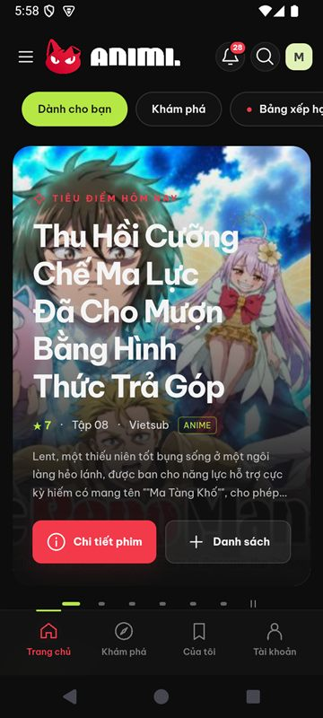
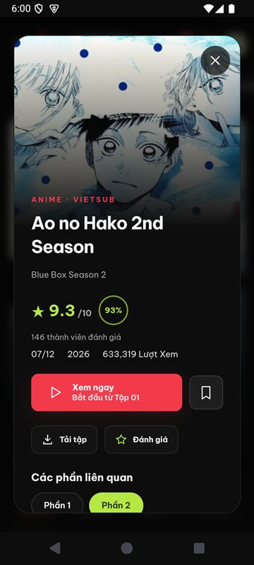
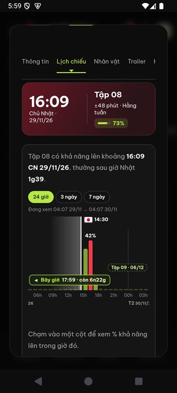
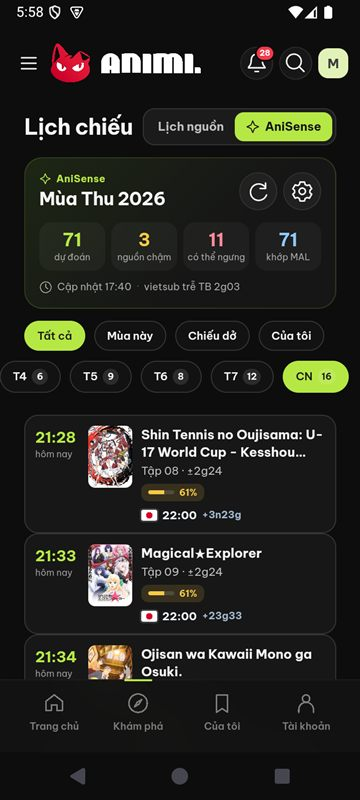
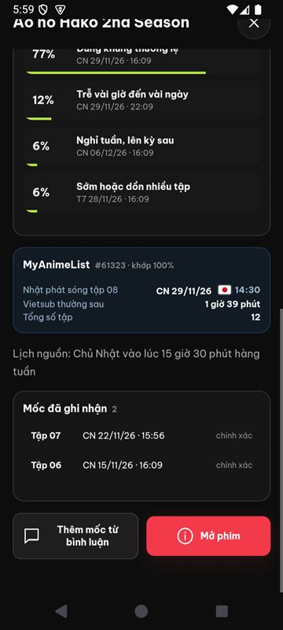
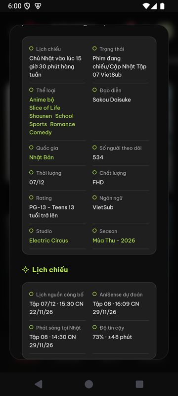
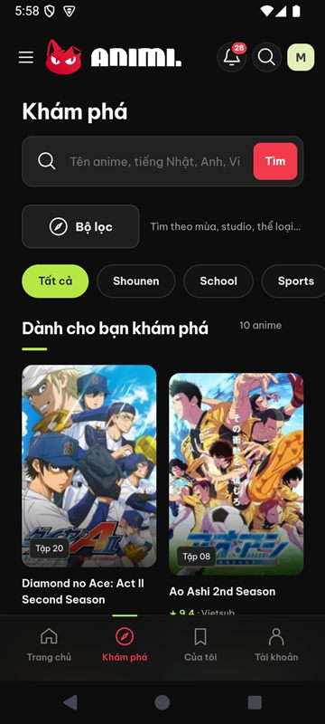
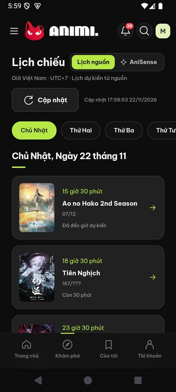
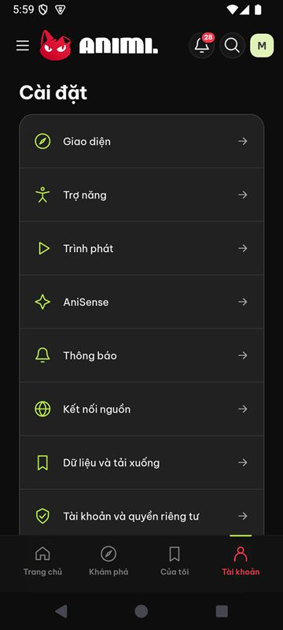

**Xem anime trên Android, gọn gàng, thuận tiện, dễ nhìn và không quảng cáo.**

---

## Giới thiệu

ANIMI là ứng dụng Android được thiết kế để tối ưu hóa việc xem anime hoàn toàn miễn phí và không quảng cáo với data được lấy trực tiếp từ AnimeVietSub thông qua máy bạn cũng như bảo đảm khả năng hoạt động độc lập chỉ cần app có kết nối với internet. Với giao diện và trình phát riêng. App không nhúng trang web để xem phim và cũng như không chạy quảng cáo của website.

## Có gì mới ở 1.2.0

### Sửa lỗi
- **DU phát lại được:** nguồn đã chuyển trình phát DU sang máy chủ mới; bản 1.1.0 không tìm thấy video DU. 1.2.0 nhận máy chủ mới và tự theo nếu nguồn đổi tiếp.

### Chọn máy chủ DU / HDX(ADS)
- **Chọn máy chủ** trong Cài đặt › Trình phát (DU mặc định) hoặc ngay khi xem: Tùy chọn phát › Máy chủ. Đổi máy chủ thì xem tiếp đúng chỗ.
- **DU lỗi thì tự chuyển sang HDX** cho tập đó; tập sau quay về DU. Tắt được trong Cài đặt.
- **HDX phát 360p–720p**, tua được, tự nạp trước để giảm giật, mất mạng ngắn thì tự phát tiếp.

### Tiện hơn
- **Bảng Tùy chọn phát mới:** chia nhóm, hiện giá trị đang dùng, bật/tắt Tự chuyển tập ngay tại chỗ.
- **Mạng ổn định hơn** trên mạng không có IPv6 thật.

Chi tiết và phạm vi kiểm thử: [Release notes v1.2.0](https://github.com/Mimaredesu/ANIMI/releases/tag/v1.2.0).

## Có gì mới ở 1.1.0

### AniSense thành "bộ não" của app
- **Trang chủ kiểu app xem phim:** các hàng Tập mới từ bộ bạn theo dõi, Dành riêng cho bạn, Vì bạn đã xem…, Vì bạn thích…, Anime mùa này, Trong danh sách của bạn, Xem lại. Mỗi thẻ ghi lý do.
- **Lịch dự đoán nhanh hơn khoảng 3 lần**, có thanh tiến trình 0–100% khi quét.
- **Nhắc tập đúng lúc:** tới giờ dự đoán, app kiểm tra các bộ bạn đang xem và báo ngay khi có tập mới.
- **Thống kê xem:** giờ xem theo tuần/tháng, thể loại và bộ xem nhiều nhất, chuỗi ngày xem.
- **Chẩn đoán sự cố:** kiểm tra từng phần của app và xuất file nhật ký (đã ẩn thông tin nhạy cảm) để gửi khi cần hỗ trợ.

### Tiện hơn
- **Dán link phim hoặc link tập** từ web AnimeVietSub vào ô tìm kiếm để mở thẳng.
- **Sao lưu và khôi phục** dữ liệu trên máy ra một tệp (Cài đặt › Dữ liệu và tải xuống).
- **Tiết kiệm dữ liệu 4G/5G:** app hỏi khi bạn dùng dữ liệu di động; các việc chạy nền chờ Wi-Fi.
- **Phát lên TV:** trình phát › Thêm › Phát lên TV, phản chiếu màn hình lên Chromecast hoặc smart TV.

Chi tiết và phạm vi kiểm thử: [Release notes v1.1.0](https://github.com/Mimaredesu/ANIMI/releases/tag/v1.1.0).

## Ảnh màn hình

| Trang chủ | Chi tiết phim | Lịch chiếu của phim |
|:---:|:---:|:---:|
|  |  |  |

| AniSense · Lịch dự đoán | Khả năng & MyAnimeList | Thông tin & lịch chiếu |
|:---:|:---:|:---:|
|  |  |  |

| Khám phá | Lịch nguồn | Cài đặt |
|:---:|:---:|:---:|
|  |  |  |

Chụp trên giả lập Android 15, chưa đăng nhập. Ảnh bìa và tên phim thuộc chủ sở hữu tương ứng.

## Tính năng chính

| Nhóm | Bạn có thể làm gì |
|---|---|
| **Khám phá** | Tìm kiếm gợi ý khi gõ, dán link phim/tập để mở thẳng, bộ lọc, lịch chiếu, bảng xếp hạng, sắp chiếu, thư viện A–Z, chọn phim ngẫu nhiên |
| **Trình phát** | Chọn máy chủ DU hoặc HDX(ADS) và tự chuyển sang HDX khi DU lỗi, tua nhanh, giữ để đổi tốc độ, bỏ qua OP/ED, tự chuyển tập, khóa màn hình, Ambient light, PiP, phát lên TV, xem bình luận |
| **Tài khoản** | Đăng nhập tài khoản nguồn, tủ phim, đánh giá, bình luận, thông báo trả lời và nhắc đến |
| **Cộng đồng** | Hồ sơ thành viên, bình luận theo tập, mở thẳng tới bình luận từ thông báo |
| **Lịch chiếu** | Lịch nguồn theo ngày, AniSense đoán giờ tập mới lên, giờ phát sóng tại Nhật, biểu đồ theo giờ |
| **AniSense** | Đề xuất kiểu app xem phim, nhắc tập đúng giờ, thống kê xem, chẩn đoán sự cố, tất cả chạy ngay trên máy |
| **Dữ liệu** | Lịch sử, xem tiếp, sao lưu và khôi phục, tiết kiệm dữ liệu 4G/5G, cài đặt và trợ năng |
| **Ngoại tuyến** | Tải tập về, lưu mã hóa và chỉ phát trong app |

## Cài đặt

1. Tải [ANIMI-1.2.0.apk](https://github.com/Mimaredesu/ANIMI/releases/download/v1.2.0/ANIMI-1.2.0.apk) về điện thoại.
2. Mở file và cho phép cài đặt nếu Android hỏi.
3. Nếu đã có bản cũ, cài đè lên để giữ dữ liệu. Bản đã cài cũng có thể cập nhật trong **Cài đặt › Về ANIMI › Cập nhật ANIMI**.

Yêu cầu Android 8 trở lên.

## Công nghệ và dịch vụ bên thứ ba

ANIMI không có máy chủ riêng: mọi yêu cầu đi thẳng từ điện thoại của bạn.

- **Ứng dụng:** Android native (Java), giao diện HTML/CSS/JS riêng đóng gói trong app, trình phát AndroidX Media3 / ExoPlayer, đọc dữ liệu bằng jsoup. AniSense (đề xuất, lịch dự đoán, thống kê, chẩn đoán) tính ngay trên máy; nhật ký lỗi và tệp sao lưu chỉ rời máy khi bạn tự xuất.
- **AnimeVietSub:** danh mục, lịch chiếu, video, bình luận và tài khoản của bạn trên nguồn.
- **HDX(ADS):** máy chủ video bên thứ ba mà AnimeVietSub liên kết. Khi bạn chọn HDX hoặc DU lỗi, app đọc thông tin phát và video MP4 trực tiếp từ nhà cung cấp này, không gửi cookie hay dữ liệu tài khoản.
- **AniList API** (công khai): giờ phát sóng tại Nhật và mã MyAnimeList cho lịch dự đoán. Chỉ gửi tên/mã anime, không gửi dữ liệu tài khoản.
- **MyAnimeList:** mã định danh và đối chiếu mùa/part, lấy qua AniList.
- **GitHub Releases:** kiểm tra và tải bản cập nhật trong app.
- **YouTube:** mở trailer bằng ứng dụng YouTube khi bạn chọn.
- **Cloudflare 1.1.1.1 / Google Public DNS:** phân giải tên miền qua HTTPS theo lựa chọn DNS trong Cài đặt. Chỉ gửi tên máy chủ cần phân giải.
- Thư viện mã nguồn mở: AndroidX Media3, AndroidX WebKit, OkHttp, Okio, Kotlin standard library (Apache 2.0), jsoup (MIT), font Be Vietnam Pro (SIL OFL 1.1). Xem trong app: **Cài đặt › Về ANIMI › Ghi công**.

ANIMI không liên kết hay được xác nhận bởi các dịch vụ trên.

## Giới hạn hiện tại

- Đăng nhập Google chỉ mở website trên trình duyệt, chưa chuyển phiên về app.
- Thông báo nền là kiểm tra định kỳ, không phải đẩy tức thì; nhắc tập AniSense hẹn theo giờ dự đoán nhưng Android vẫn có thể lùi để tiết kiệm pin.
- Máy chủ DU hiện chỉ có một mức chất lượng, nên tiết kiệm dữ liệu không giảm được dung lượng video DU.
- HDX chưa hỗ trợ bản 1080p (dùng AV1); tua tới đoạn HDX chưa ai xem có thể chậm vài giây; tải tập về máy vẫn dùng DU.
- Phát lên TV là phản chiếu màn hình: điện thoại phải mở, chất lượng phụ thuộc Wi-Fi; chưa có Chromecast trực tiếp.
- Lịch sử chỉ có trên web không kèm mốc thời gian, nên app không biết bạn đã xem hết tập đó chưa.
- Lịch dự đoán là ước tính từ lịch sử đăng tập, không phải lịch chính thức; điểm bạn tự chấm trên website chưa hiện được trong app.
- App phụ thuộc vào website nguồn và server video, nên có thể lỗi khi nguồn thay đổi hoặc chặn kết nối. DNS qua HTTPS chỉ sửa được chặn DNS; khi mạng ngắt kết nối tới nguồn cần mạng khác hoặc WARP/VPN, và qua một số VPN nguồn có thể đòi xác minh trình duyệt mà app không tự vượt.
- Chưa hỗ trợ Encrypted Client Hello (ECH): Android chỉ có tính năng này từ Android 17.

## Kiểm tra file

| File | Kích thước | SHA-256 |
|---|---|---|
| `ANIMI-1.2.0.apk` | 5.095.934 byte | `bc3cbbdabc8d3abf651c2c788e002ba1fb76073529430679f3e5a242323012ce` |

---

ANIMI là ứng dụng độc lập, không phải sản phẩm chính thức của AnimeVietSub. Nội dung và thương hiệu của bên thứ ba thuộc về chủ sở hữu tương ứng. Tôi cũng đồng thời tuyên bố từ chối mọi trách nhiệm của toàn bộ nội dung liên quan đến quyền sở hữu trí tuệ tại AnimeVietsub.
